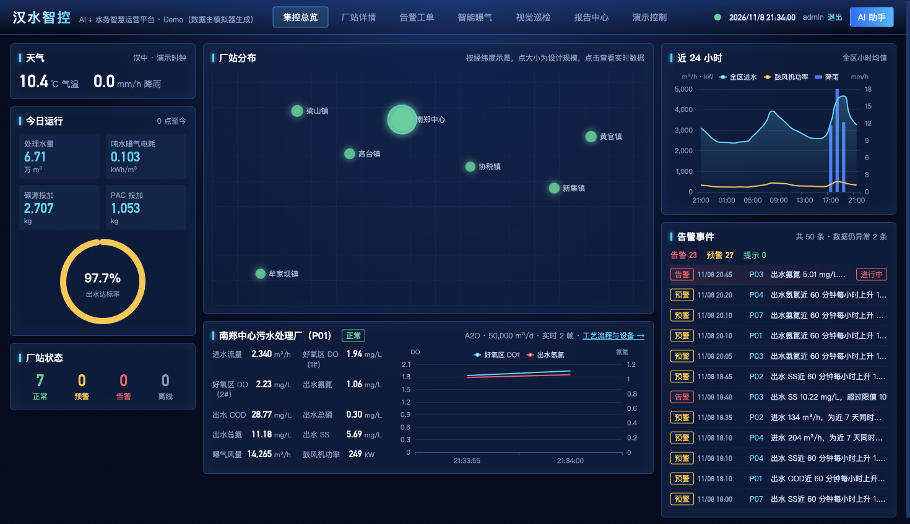
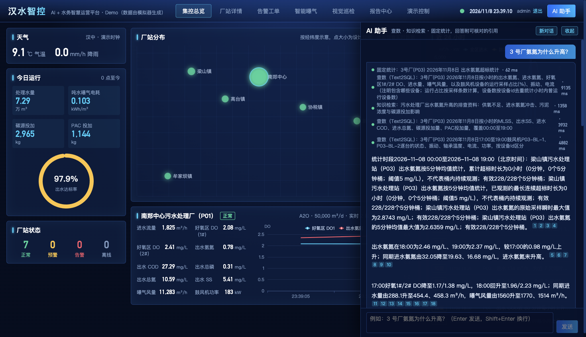
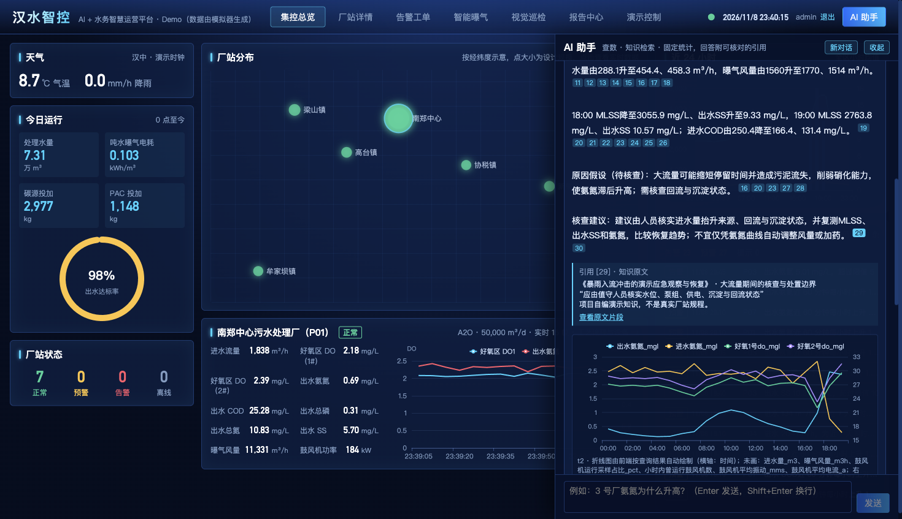
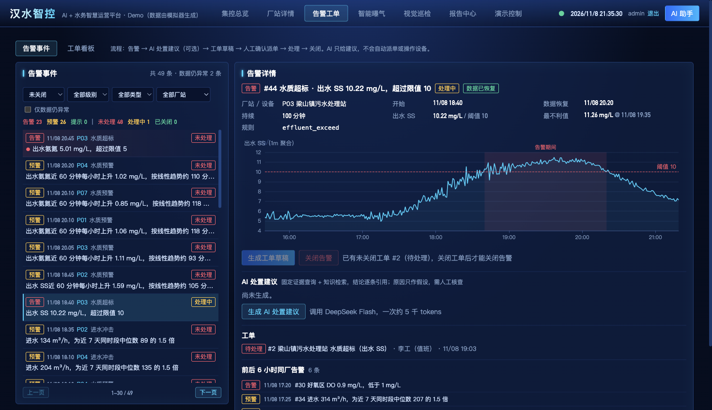
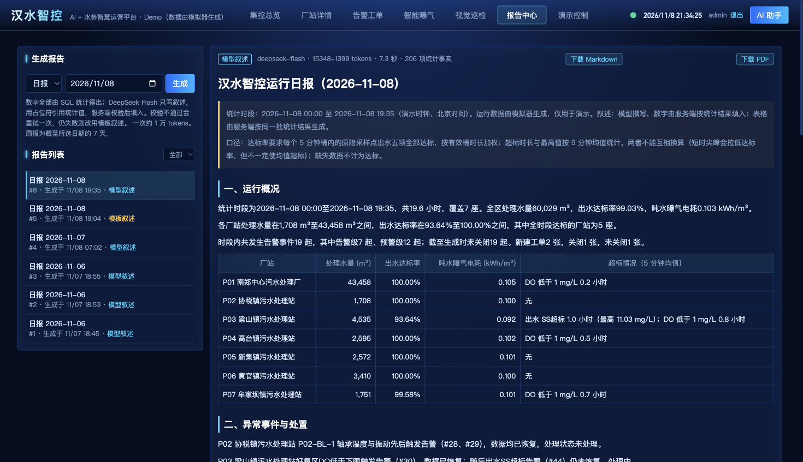
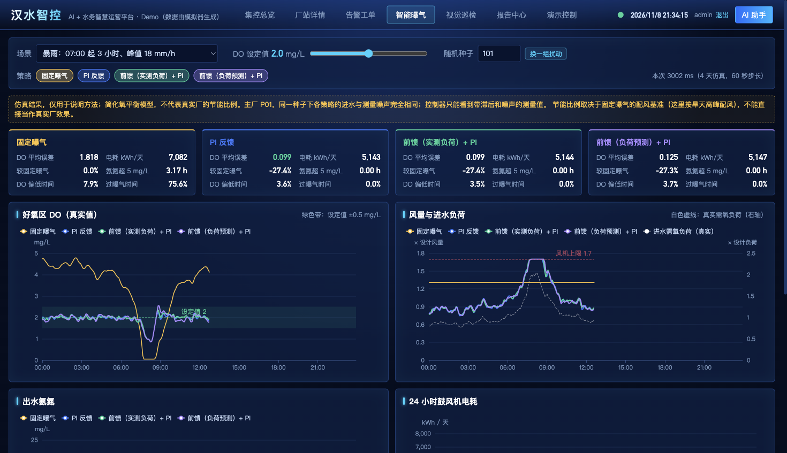
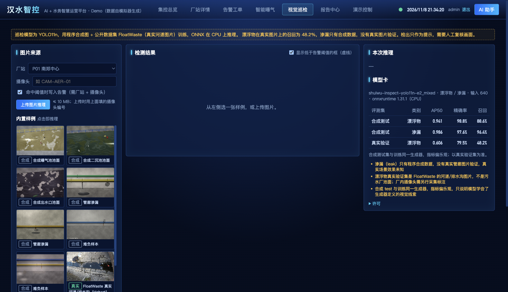
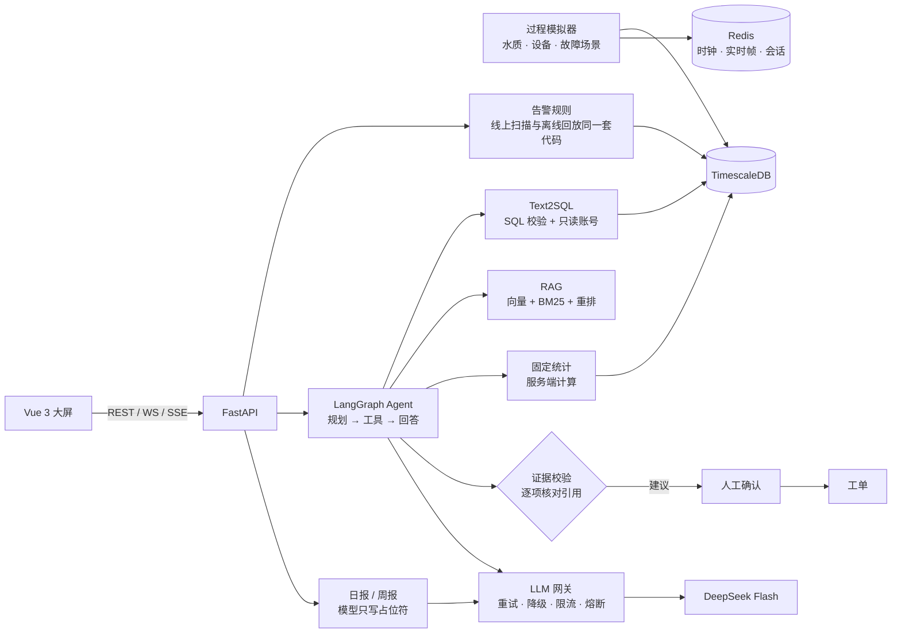

# 汉水智控：AI+水务智慧运营平台（Demo）

面向县域「1 中心厂 + N 集镇厂」污水处理的 AI 演示项目：模拟运行数据 → 告警 → AI 查数与诊断 → 人工确认派单 → 自动日报。

> **这是技术 Demo，不是验证过的水务产品。** 所有运行数据由模拟器生成，厂站名称借用南郑区地名，规模、工艺和数据均为虚构。诊断能力的语义正确性尚未完成人工核查（见下方评测表）。



| AI 助手：查询过程与逐条引用 | AI 助手：原因假设、核查建议与原文核对 |
| --- | --- |
|  |  |
| **告警与工单** | **运行日报** |
|  |  |
| **智能曝气仿真** | **视觉巡检** |
|  |  |

## 架构



## 核心设计

- **模型不碰数字。** 回答里的每个单元格和知识摘录都由服务端逐项核对；时长、极值、排名由服务端计算并生成整句；日报里模型只能写占位符，数值由服务端填入。
- **AI 只读，写入要人确认。** Agent 只有三个只读工具，派单必须人工确认。未设置管理员密码时写接口全部拒绝。
- **SQL 双层防护。** sqlglot 校验（单条 SELECT、表和函数白名单）加上数据库只读账号（只授权 6 张表，语句超时 5 秒）。
- **失败结果保留。** 评测的不利结果和中间记录都留在仓库里，比如只用合成数据训练时真实 AP50 只有 0.229、前馈和负荷预测基本没有增益。

## 评测结果

| 模块 | 结果 | 这个数字不能说明什么 |
| --- | --- | --- |
| Agent 诊断（22 题） | 机械检查 21/22；**语义通过 3 题，18 题待人工核查** | 机械检查只核对数值、单位和引用结构，不是诊断准确率；题目、模拟器和知识库都是本项目自己写的 |
| Text2SQL（64 题） | 默认配置 61/64，补充采样约定后单轮复测 63/64 | 自建开发集，单轮有采样波动，不等于真实业务准确率 |
| RAG（30 道可答题） | Recall@5 100%，MRR@5 从 0.892（BM25）到 0.983（混合 + 重排） | 只有 35 个片段，小语料有上限效应 |
| 告警规则 | 23/24 场景检出，126 个厂站·天误报 0 | 只适用于模拟数据 |
| 日报叙述（Flash，9 次） | 一次通过 9/9，其中 2 次靠解析容错 | 占位符通过不等于叙述完全正确 |
| 视觉巡检（真实漂浮物） | AP50 从 0.229（只用合成）到 0.606（加 546 张真实图） | 小目标召回 0.22；渗漏没有真实数据，真实效果未知 |
| LLM 网关（假厂商压测） | 限流场景成功率 7.3% → 100% | 假厂商，不代表真实厂商高峰 |
| 曝气控制（仿真） | PI 较固定曝气省电约 29%；前馈与负荷预测相对 PI 差异在 ±0.1% 内 | 简化模型，比例取决于固定曝气的基准 |

## 文档

| 主题 | 文档 |
| --- | --- |
| 功能清单、页面说明 | [docs/pages.md](docs/pages.md) |
| 接口 | [docs/api.md](docs/api.md) |
| Text2SQL 与消融评测 | [docs/text2sql.md](docs/text2sql.md) |
| RAG 知识问答 | [docs/rag.md](docs/rag.md) |
| Agent、22 题诊断评测 | [docs/agent.md](docs/agent.md) |
| 告警、工单、日报 | [docs/operations.md](docs/operations.md) |
| 视觉巡检 | [docs/vision.md](docs/vision.md) |
| 曝气仿真 | [docs/aeration.md](docs/aeration.md) |
| 过程模型、数据表 | [docs/data-model.md](docs/data-model.md) |
| 设计取舍 | [DESIGN.md](DESIGN.md) |

## 快速开始

首次启动时，从 `.env.example` 新建本地 `.env`；已有 `.env` 时直接编辑，保留自己的配置。需要 AI 功能时，在本地填写 `DEEPSEEK_API_KEY`，模型保持 `deepseek-flash`。还需在 `.env` 设置 `ADMIN_PASSWORD`（管理员账号 `admin`）：查看页面不用登录，生成报告、调用 AI、派单、演示控制等操作要先登录；未设置时这些操作一律返回 401。

```bash
docker compose up -d --build      # 首次启动会回填 7 天历史数据（约 20 秒）
docker compose logs -f simulator
open http://localhost:15173       # 大屏（nginx，/api 与 /ws 同源代理到 api）
open http://localhost:8000/docs   # API 文档
```

端口被占用时在 `.env` 里改 `WEB_PORT` / `API_PORT` / `DB_PORT` / `REDIS_PORT`。

本机开发（需要 [uv](https://docs.astral.sh/uv/)）：

```bash
docker compose up -d db redis
cd backend
uv sync
uv run pytest                          # 全量测试（含独立测试库的集成测试）
uv run python -m simulator run         # 库为空时先回填，再实时运行
uv run python -m simulator run --reset # 清空运行数据，重新回填
uv run uvicorn app.main:app --reload   # API（另开终端）
```

`evals/` 下调用 HTTP 接口的验收脚本会先用 `.env` 里的 `ADMIN_PASSWORD` 登录（`evals/http.py`），口令须与被测服务一致。

前端开发（Node 20.19+，Vite 7 的要求）：

```bash
cd frontend
npm ci
npm run dev        # http://localhost:5173，Vite 把 /api 与 /ws 代理到 127.0.0.1:8000（API_TARGET 可改）
npm run build      # vue-tsc 类型检查 + 生产构建到 dist/
npm test           # 自动图表规则单元测试（node:test，无额外依赖）
```

本机设置了 `HTTP_PROXY` 时，启动 Vite 前加 `NO_PROXY=127.0.0.1,localhost`，否则代理请求会被转到系统代理。

## 演示场景

```bash
cd backend
uv run python -m simulator scenarios                       # 列出场景
uv run python -m simulator speed 60                        # 演示时钟 60 倍速（1 秒 = 1 分钟）
uv run python -m simulator inject storm                    # 全区暴雨：P03 梁山镇进水激增、污泥流失，雨停后氨氮超标
uv run python -m simulator inject blower_fault --plant P01 # 鼓风机振动升高 → 30 分钟后跳停 → DO 下降
uv run python -m simulator inject pipe_leak --plant P05    # 碳源管道渗漏 → 投加量异常升高
uv run python -m simulator inject dosing_block --plant P02 # PAC 加药泵堵塞 → 出水总磷超标
uv run python -m simulator clear                           # 结束全部场景
uv run python -m simulator speed 1
```

在 Docker 中运行时，把 `uv run python` 换成 `docker compose exec simulator python`。

## 部署说明

Compose 把数据库、Redis、API 的端口只绑定到 `127.0.0.1`，对外只有 web（nginx）。公开部署前还需要改掉默认数据库密码（`.env.example` 里是开发值）、设置 `ADMIN_PASSWORD`，并把 web 放到 HTTPS 后面（同时设置安全 Cookie）。

## 许可

代码以 [AGPL-3.0](LICENSE) 发布。选择它是因为仓库里的视觉模型权重（`backend/models/vision/inspect.onnx`）由 Ultralytics YOLO 微调而来，同受 AGPL-3.0 约束。漂浮物样例图片来自 [FloatWaste](https://doi.org/10.5281/zenodo.21934286)（CC BY 4.0），逐张署名见 `backend/models/vision/samples/samples.json`。
